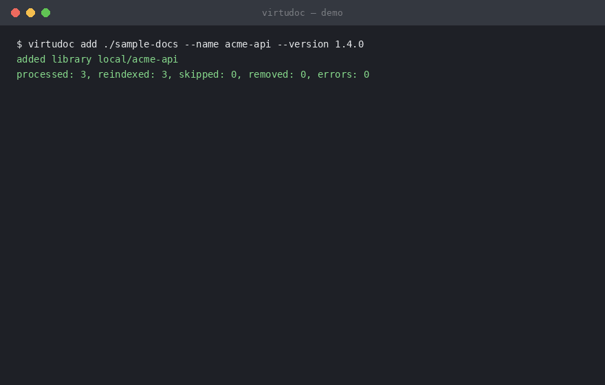

# VirtuDoc

[](https://github.com/saromanov/virtudoc/actions/workflows/ci.yml)
[](https://codecov.io/gh/saromanov/virtudoc/)
[](https://pypi.org/project/virtudoc/)
[](https://pypi.org/project/virtudoc/)
[](https://github.com/saromanov/virtudoc/blob/main/LICENSE)

<p align="center"></p>

**The problem it solves.** Coding agents re-download the same documentation
every session, work only with public APIs, and invent your internal
interfaces because your private docs were never reachable. VirtuDoc fixes the
context side: your documentation is indexed once, locally, and served to any
MCP client — verified fragments, not model guesses.

VirtuDoc is a local documentation server for AI agents. It indexes
documentation from local directories into SQLite with FTS5 full-text search
and serves relevant fragments to an agent through MCP tools. Fully offline:
no network access happens in any mode.

Private and internal docs never leave your computer: there are no API keys,
request limits, or cloud dependencies.

## Installation

```bash
pipx install virtudoc   # isolated CLI install, recommended
# or
pip install virtudoc
```

Requires Python 3.11+. The only runtime dependencies are `markdown-it-py`
(Markdown parsing) and the `mcp` SDK.

Releases are built and published to PyPI by GitHub Actions on `v*` tags
through OIDC trusted publishing — no tokens are stored in the repository.

## Quick start

```bash
# Register a documentation directory and index it
virtudoc add /path/to/docs --name mylib --version 2.1.0

# Index statistics
virtudoc list

# Search from the terminal (same results an agent will get via MCP)
virtudoc search "how to handle authentication errors"

# Incremental reindexing after the docs changed
virtudoc update              # all libraries
virtudoc update --name mylib

# Full rebuild of one library (applies changed chunk.* settings)
virtudoc reindex mylib

# Remove a library
virtudoc remove mylib

# Attach a team convention note to a library (agents receive it with docs)
virtudoc note add mylib --text "Use the retry helper for all outbound calls."

# Warn when the indexed docs version diverges from the project dependency
virtudoc link mylib --project /path/to/consuming/project
virtudoc doctor   # config, sources, index integrity, version drift summary

# Zero-config onboarding: scan the project's manifests and match libraries
virtudoc init .              # report only; add --link to create the links

# Pull public documentation from a git URL or archive (the only networked command)
virtudoc fetch --repo https://github.com/org/docs --name theirlib

# Move your whole setup to another machine (see docs/installation.md)
virtudoc export            # dump the library list to ~/.virtudoc/libraries.toml
virtudoc import            # register and index everything from the file
```

## Connect your agent

Run the MCP server and register it in your agent's config. The server speaks
stdio by default and refreshes a library incrementally when an agent first
requests it, so the agent always sees current documentation. Agents spawn the server with a
default environment, so the data directory is `~/.virtudoc` — set
`VIRTUDOC_HOME` in the server `env` block if you need a custom location.

**Claude Code** — add to `.mcp.json` in your project (or run
`claude mcp add virtudoc --scope user -- virtudoc serve`):

```json
{
  "mcpServers": {
    "virtudoc": {
      "command": "virtudoc",
      "args": ["serve"]
    }
  }
}
```

**Cursor** — add to `.cursor/mcp.json`:

```json
{
  "mcpServers": {
    "virtudoc": {
      "command": "virtudoc",
      "args": ["serve"]
    }
  }
}
```

**OpenCode** — add to `opencode.json` (project root or
`~/.config/opencode/opencode.json`):

```json
{
  "$schema": "https://opencode.ai/config.json",
  "mcp": {
    "virtudoc": {
      "type": "local",
      "command": ["virtudoc", "serve"],
      "enabled": true
    }
  }
}
```

## MCP tools

- `find-library(libraryName, query)` — find the `local/<name>` id of a
  library by its name and your question. Call it first.
- `get-library-docs(libraryId, query, tokens=5000, language, page, mode,
  section)` — Markdown fragments with heading paths and source file paths,
  assembled under the token budget. `total_matches` and `has_more` describe
  pagination; `page=N+1` continues the ranking. `section` restricts the
  answer to a heading branch and takes a path, e.g.
  `"Guide → Authentication"` or a top-level branch name (`"Guide"`) — a
  bare leaf name alone does not match. Relevant project notes are
  included before the fragments. Empty results return the library's
  top-level sections to help rephrase the query.

Optionally expose the server over streamable HTTP on 127.0.0.1 for clients
without stdio support: `virtudoc serve --http [port]` (default port 8765).

## Why not Context7 or a RAG index?

- **Hosted doc servers (Context7 and similar)** serve public documentation
  from the network. VirtuDoc indexes the docs you actually work with: private
  repos, internal specs, vendored doc trees. Nothing leaves your machine —
  no API keys and no rate limits.
- **Embedding-based RAG** needs an embedding model, a vector store and
  re-embedding on every doc change. VirtuDoc is SQLite FTS5 with BM25: one
  `pip install`, incremental indexing by content hash, and deterministic
  results — the same query returns the same fragments.
- **Documentation structure fits BM25 better than similarity search:**
  chunks are cut along headings, results carry their section path, and the
  token budget is respected exactly — so an agent gets a predictable,
  bounded context.

If you only consume public docs and prefer hosted infrastructure, Context7
is a good fit. If your documentation is private, internal or must stay
offline, that is the gap VirtuDoc closes.

Supported formats: Markdown (`.md`, `.mdx`), reStructuredText (`.rst`),
plain text (`.txt`), HTML (`.html`, `.htm`, best-effort text extraction).
Hidden files and directories are always skipped; a `.virtudocignore` file at
the source root (`.gitignore`-compatible syntax: globs, `**`, `!` negation,
directory patterns) excludes generated or vendor trees from indexing.

## How it works

- The **chunker** splits documents along H2/H3 headings (target chunk size
  600 tokens, hard limit 1200, 60-token overlap); code blocks are never split.
- **Search** is SQLite FTS5 with BM25 ranking; fragment scores are BM25
  values, not positions. Queries cascade: exact `AND` → prefix `AND` with
  Russian ending / English suffix stemming → `OR`, so Russian inflections
  (`пакетная` finds `пакетной`) and fuzzy phrasing both resolve.
- Results are assembled under a token budget (default 5000) with a
  topic boost for chunks whose heading path matches the query on token
  boundaries.
- **Indexing is incremental**: unchanged files are skipped by content hash.
- All data lives in `~/.virtudoc/` (WAL-mode `index.db`, config, log).
  Deleting the directory removes the system completely.

## Configuration

`~/.virtudoc/config.toml` (all keys optional):

```toml
[chunk]
target_tokens = 600
max_tokens = 1200
overlap_tokens = 60

[search]
default_tokens = 5000
max_results = 20

[log]
level = "INFO"
```

Changing `chunk.*` only affects new indexing; the existing index is not
rebuilt automatically.

## Documentation

- [docs/](docs/index.md) — full documentation: installation, getting
  started, CLI reference, MCP integration, configuration, indexing and
  search internals, project notes, version drift warnings
- [ARCHITECTURE.md](ARCHITECTURE.md) — components, data flows, storage schema

## Development

```bash
pip install -e '.[dev]'
pytest
ruff check virtudoc tests
ruff format virtudoc tests
```

## Status

Milestones M1 (core: indexing, chunking, FTS5 search, CLI) and M2 (MCP
server over stdio/HTTP, project notes, outline mode, `.virtudocignore`) are
done, plus `link`/`doctor` version drift warnings and the `fetch` command.
Published on PyPI.

## License

MIT, see [LICENSE](LICENSE).
